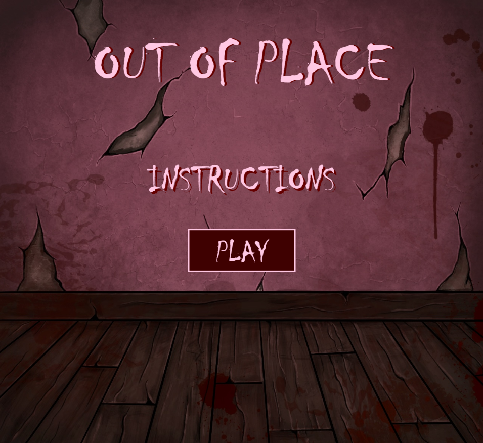
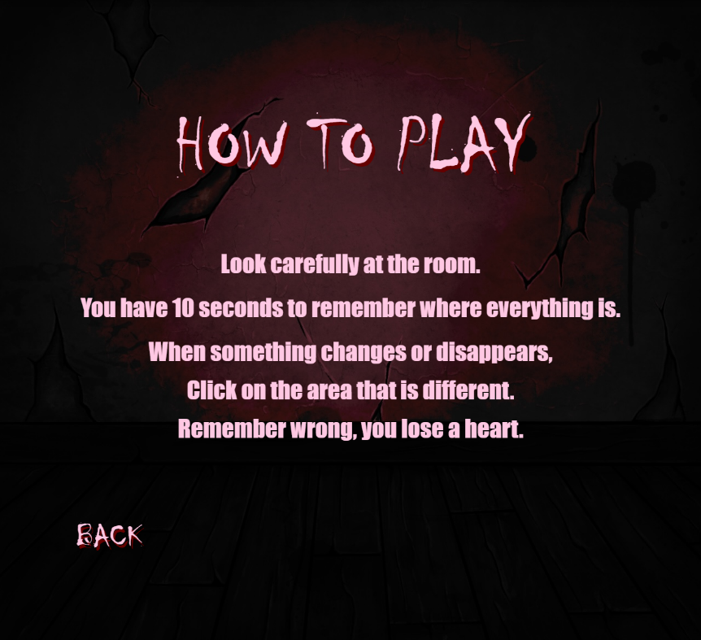
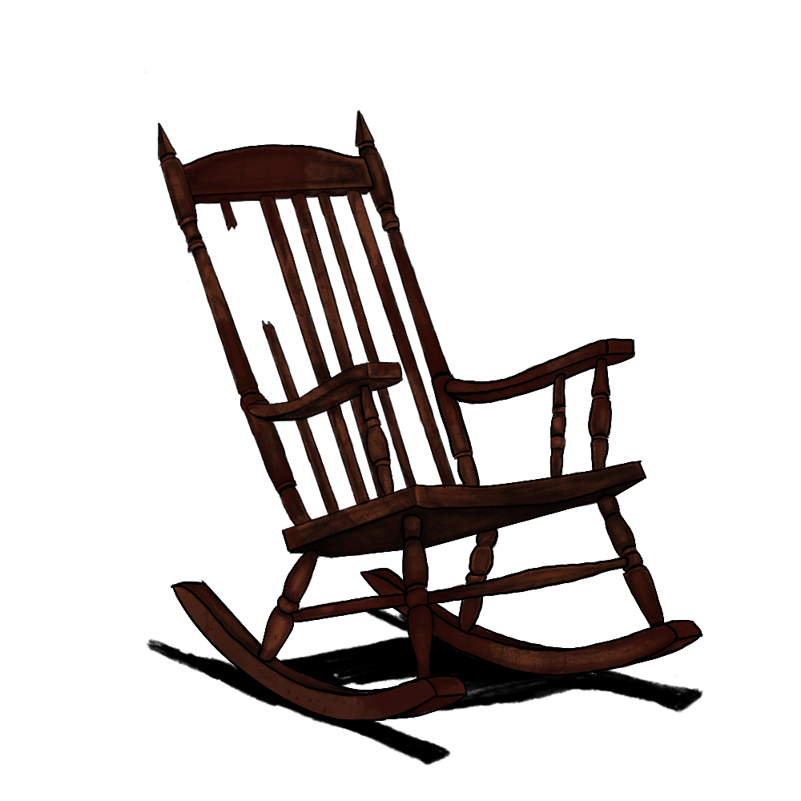
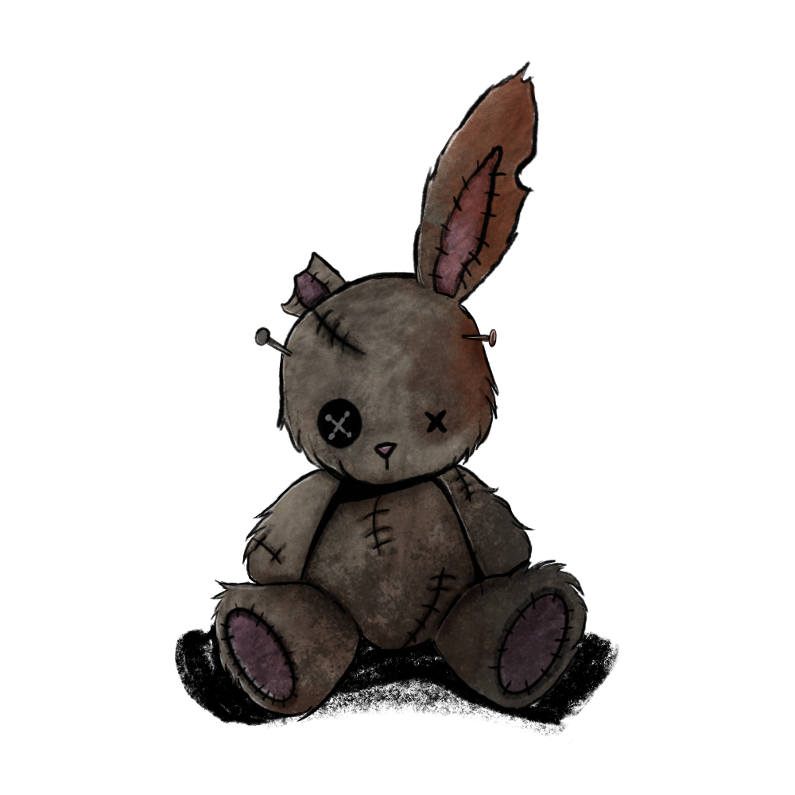
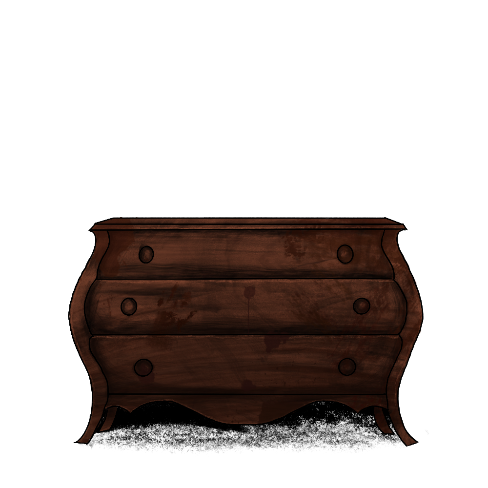
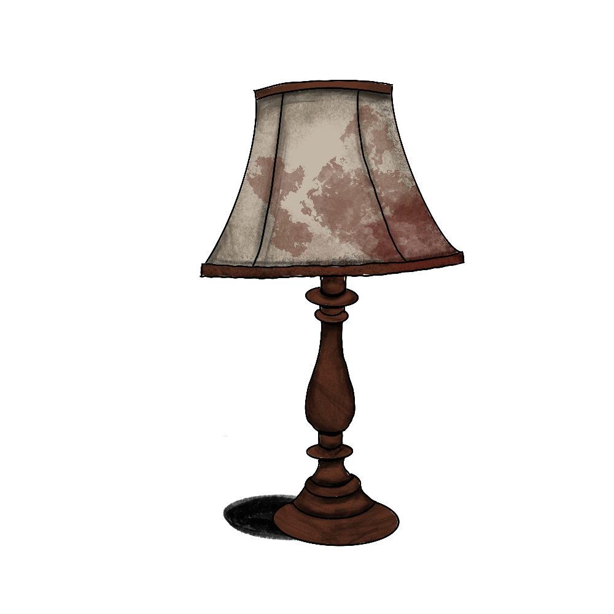
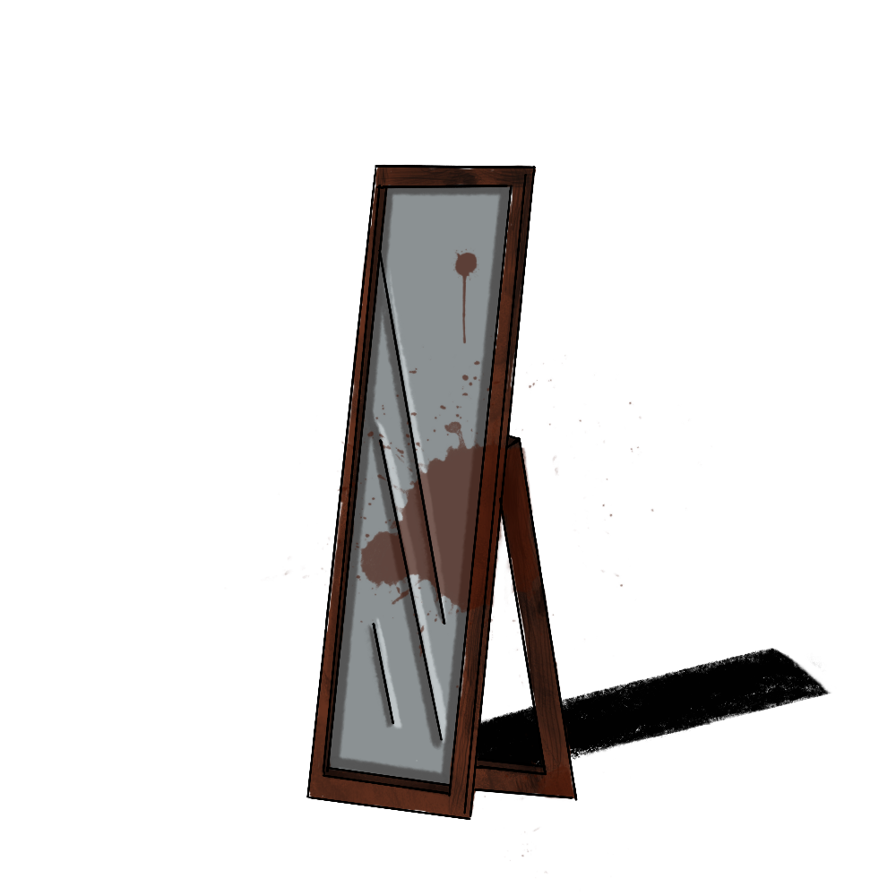
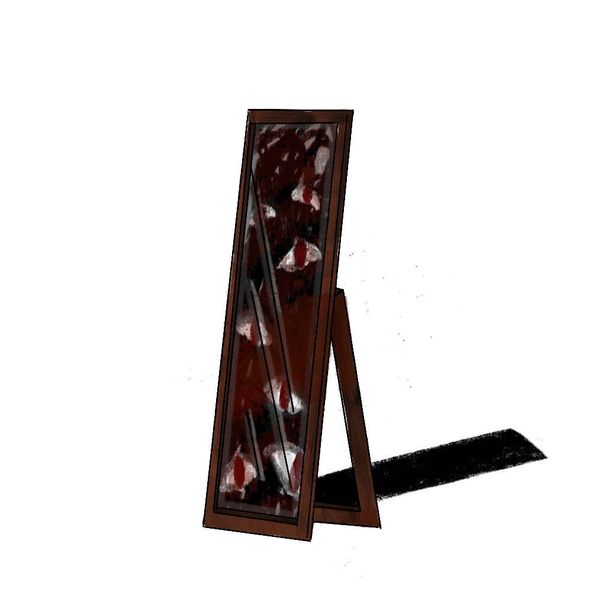
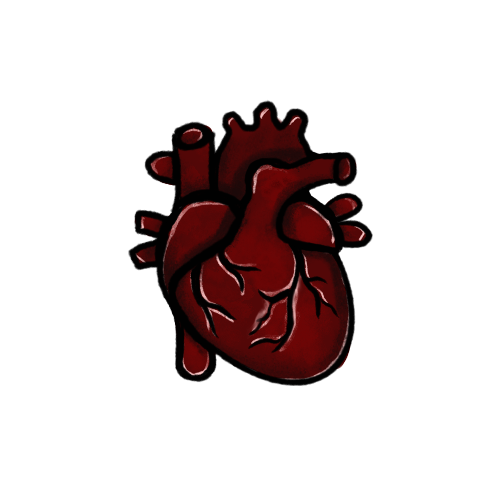

# Out of Place 

Athanasia (Sia) Iliopoulos 

[Out of Place](https://siachia.github.io/CART253/topics/prototypes/Final%20prototype/)

## Description

Out of Place is a horror-themed memory game where something is never quite where you left it. 

You enter this mysterious, unsletting room and have 10 seconds to memorize everything that is inside of it. Once the timer is up the screen goes black. When the screen returns, something is now missing. 

Your job is to survive the room and figure out what is missing or different by clicking on the correct area. However, you must proceed with CAUTION as guessing wrong decreases your health. If you lose all your hearts, you die. 

This game combines visual storytelling, art, memory-based gameplay and a creepy environment to create a horror experience, that will leave you looking over your shoulder. 

## Gameplay Instructions and Controls

The game is controlled using your mouse.

• PLAY: Click the Play button to access the level selection screen.

• INSTRUCTIONS: On the game title screen, click to view the game instructions.

• BACK: Return to the previous menu.

• LEVEL SELECTION: Click the level you want to play (recommended to start level 1) to begin playing.

• MEMORIZE: You have 10 seconds to study the room and remember all the objects.

• FIND THE CHANGE: After the black screen, click the location where the missing object used to be.

• HEALTH: You start with three hearts and they are on the top left side your screen. Each incorrect click causes you to lose one heart, depleting your health.

• RETRY: If you died and lost all your hearts, click Retry to restart the level.

## Visuals 

### Title screen

### Instructions Screen

### Level Selection

### Objects 

#### Rocking Chair

#### Stuffed Bunny Plush

#### Dresser

#### Lamp

#### Mirror

#### Corrupted Mirror

#### Health

## Attribution

> - All images/illustrations were created by Athanasia (Sia) Iliopoulos
> - Original illustrations and game assets were created by using the drawing software Procreate. 
> - This project uses [p5.js](https://p5js.org).

## License

> This project is licensed under a Creative Commons Attribution ([CC BY 4.0](https://creativecommons.org/licenses/by/4.0/deed.en)) license with the exception of libraries and other components with their own licenses.